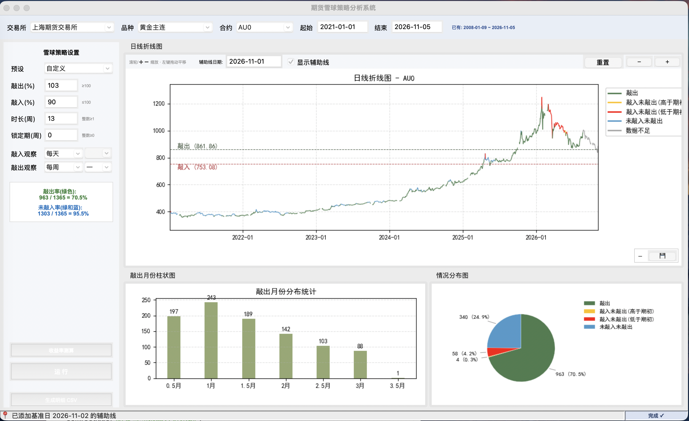
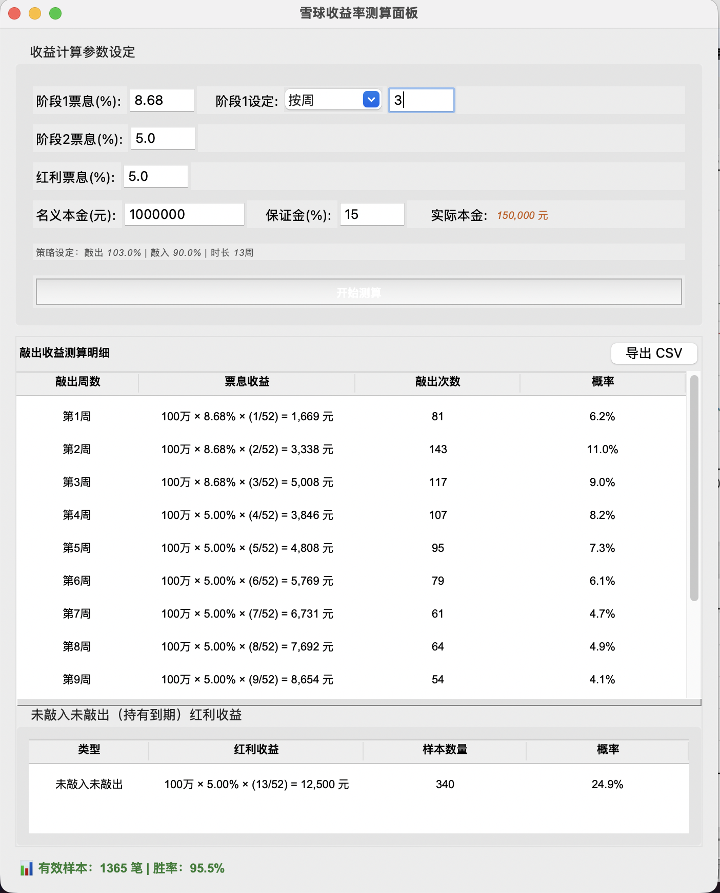

# 期货与股指雪球策略回测与收益分析系统

基于 Python + Tkinter 开发的桌面级量化回测工具。系统支持全市场（国内期货 + 股票指数）历史日线数据获取，精准复刻真实雪球产品结构（含敲入敲出、锁定期、阶梯票息），并提供专业级交互式图表与精确到天的收益测算闭环。

## ✨ 核心功能

- **全市场数据覆盖**：无缝对接上期所、大商所、郑商所、中金所及四大股指（沪深300、中证500等），支持主力连续与具体合约。
- **本地化高速仓储**：基于 SQLite3 构建数据底层，实现按天增量缓存；剔除低流动性“假数据”，并设计了第三方接口宕机时的备用容错探测机制。
- **真实金融条款还原**：
  - 支持自定义敲入/敲出比例（≥100% / ≤100%）。
  - 支持独立设置敲入/敲出观察频率（每日 / 每周 / **自然日30天滚动遇假顺延**）。
  - 支持设置敲出锁定期，精准还原各种结构变体。
- **专业级交互图表**：
  - **分段染色折线图**：采用 `LineCollection` 高性能渲染，直观展示历史期初点的四种敲入/敲出状态。
  - **敲出分布图与饼图**：一键生成敲出月份统计柱状图和状态占比扇形图。
  - **指定日期辅助线**：支持输入特定日期，动态生成该日期的敲入/敲出基准线（Y轴自适应缩放）。
- **收益测算闭环（亮点）**：
  - 独立的收益率精算面板，支持“早利（前高后低）”及“递增”等阶梯票息。
  - 根据日/周/月自动切换计息基准，动态生成如 `100万 × 8.68% × (4/52)` 的直观公式。
  - 提供未敲入未敲出（红利收益）的保底测算。
- **数据与报表导出**：支持将底层的每一笔状态判定明细（如某天是观察日、某天触发敲出）及收益测算表格一键导出为 CSV。

<div align="center">
  
  <p>主界面及回测参数设置</p>
  
  
  <p>收益测算与动态图表展示</p>
</div>

## 🛠️ 技术栈
- **前端界面**：Tkinter / ttk
- **数据可视化**：Matplotlib (LineCollection 渲染、mpl_connect 事件监听)
- **数据处理与算法**：Pandas / Numpy / Dateutil (复杂时序与日历处理)
- **数据持久化**：SQLite3 (联合主键、增量缓存)
- **数据获取**：akshare (多数据源容灾)
- **并发与异步**：Threading / Queue (保证重计算时 UI 丝滑不卡顿)

## 🚀 如何运行

1. 克隆或下载本项目。
2. 安装依赖：
   ```bash
   pip install -r requirements.txt
3. 启动程序：
   ```bash
   python GUI.py

 
## 免责声明
本项目不构成任何投资建议！！！
